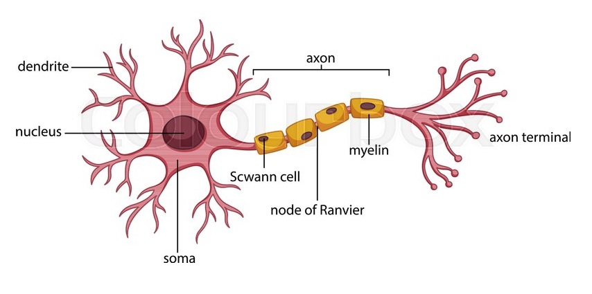

# NRouter - 基于神经网络思想的 Android 组件化路由框架

## 神经网络路由-你的组件化从这里开始



## 📖 项目简介

NRouter 是一个借鉴生物神经网络原理设计的 Android 组件化路由框架，支持模块间解耦导航、有参/无参路由、URL 导航等特性。框架核心类名全部来源于神经元解剖学术语，将生物神经信号传导机制巧妙映射到路由系统设计中。

## 🧬 核心概念：生物神经元映射

NRouter 将生物神经元的结构与路由系统的功能进行了精妙对应：

| 生物概念 | 代码类 | 路由职责 |
|---------|--------|---------|
| **神经元** | `Nucleus` | 路由匹配的基本单元，定义 scheme/host/port 规则 |
| **胞体** | `Soma` | 拥有路径匹配能力的神经元，可处理无路径/其他路径等场景 |
| **纯胞体** | `SomaOnly` | 只处理 scheme/host 级别匹配，不关心路径 |
| **降级胞体** | `SomaFallback` | 兜底处理，优先级最低 |
| **轴突分支** | `AxonBranch` | 具体的路径匹配规则 + 对应的跳转动作 |
| **树突** | `Dendrite` | 接收信号并触发实际的页面跳转（`startActivity`） |
| **信号** | `Signal` | 携带路由信息的载体（URI、参数、变量等） |
| **轴突末梢** | `AxonTerminal` | 按路径层级分类存储的分支映射表 |

### 神经信号传导类比

```
生物神经元：树突接收信号 → 胞体处理 → 轴突传导 → 轴突末梢释放神经递质
NRouter：   URL输入 → Nucleus匹配 → Soma决策 → AxonBranch执行 → Dendrite跳转
```

## 🏗️ 架构设计

### 整体架构图

```
┌─────────────────────────────────────────────────────────────┐
│                      业务模块层                              │
│  HomeActivity  LoginActivity  MeActivity  MessageActivity   │
│              (使用 @Route 注解标注路由路径)                    │
└────────────────────┬────────────────────────────────────────┘
                     │ KSP 编译期处理 @Route
┌────────────────────▼────────────────────────────────────────┐
│                    路由核心层                                 │
│                                                              │
│  NeuroRouter (单例入口)                                      │
│       │                                                      │
│       ├─► Neuro (路由引擎)                                   │
│       │      │                                               │
│       │      ├─► Nucleus/Soma (路由规则定义)                  │
│       │      ├─► AxonBranch (路径匹配规则)                    │
│       │      ├─► AxonTerminal (分层索引存储)                  │
│       │      └─► Signal (路由信号)                            │
│       │                                                      │
│       └─► Dendrite (跳转执行器)                              │
│              └─► startActivity()                             │
└──────────────────────────────────────────────────────────────┘
                     ▲
                     │ ServiceLoader 发现
┌────────────────────┴────────────────────────────────────────┐
│                   编译期代码生成                               │
│  KSP RouteProcessor → 生成 RouteLoader + META-INF/services  │
└──────────────────────────────────────────────────────────────┘
```

## 🔄 工作流程

### 一、路由注册流程

```
编译期（KSP 注解处理）
    │
    ▼
RouteProcessor 扫描所有 @Route 注解
    │
    ▼
为每个模块生成 RouteLoader 类（实现 IRoute 接口）
    │
    ▼
同时生成 META-INF/services 服务配置文件
    │
    ▼
运行期
    │
    ▼
Application.onCreate()
    │
    ▼
NeuroRouter.instance.init(application)
    │
    ▼
ServiceLoader 发现所有模块的 RouteLoader
    │
    ▼
调用 register() 方法自动注册路由路径
    │
    ▼
Neuro.connect() 建立神经元连接
```

### 二、路由匹配流程

```
NeuroRouter.navigation("/home_act", context)
    │
    ▼
自动补全为 cherry://com.cherry.router/home_act
    │
    ▼
Neuro.proceed() ──► findRoute(url)
    │
    ▼
解析 URI: scheme / host / port / path
    │
    ▼
【第一级匹配】遍历 neurons 查找匹配的 Nucleus
    │
    ├─► isMatch(scheme, host, port) 正则匹配
    │
    ▼
【第二级匹配】获取 AxonTerminal，按 pathCount 筛选候选分支
    │
    ├─► 精确路径匹配优先（index = pathCount）
    ├─► 通配符路径兜底（index = -pathCount）
    │
    ▼
extractSignal() 提取路径变量和查询参数
    │
    ▼
Soma.onSomaProcess() 胞体处理
    │
    ▼
执行 AxonBranch.action
    │
    ▼
Dendrite.navigation() ──► startActivity()
```

### 三、路径分层索引算法

NRouter 使用路径段数作为索引，实现高效匹配：

```kotlin
typealias AxonTerminal = ConcurrentSkipListMap<Int, ConcurrentSkipListSet<AxonBranch>>
```

**索引规则：**
- 路径 `/aaa/bbb/ccc` → `pathCount = 3` → 存入 `index = 3`
- 含通配符的路径 → 存入 `index = -pathCount`（负数索引）

**匹配策略：**
对于 `pathCount = 5` 的路径，会搜索索引 `5, -5, -4, -3, -2, -1` 的分支，实现**精确匹配优先、通配符兜底**。

## 🚀 快速开始

### 1. 添加 JitPack 仓库

在项目根目录的 `build.gradle` 中添加：

```groovy
allprojects {
    repositories {
        maven { url "https://jitpack.io" }
    }
}
```

### 2. 添加依赖

```groovy
dependencies {
    implementation 'com.github.Victor2018.NRouter:neuro_router_core:latestVersion'
    ksp 'com.github.Victor2018.NRouter:neuro_router_compiler:latestVersion'
}
```

### 3. 初始化

在 `Application.onCreate()` 中初始化：

```kotlin
class App : Application() {
    override fun onCreate() {
        super.onCreate()
        NeuroRouter.instance.init(this)
    }
}
```

### 4. 注册路由

在业务模块的 Activity 类上添加 `@Route` 注解即可，KSP 会在编译期自动生成路由注册代码：

```kotlin
// 默认 exported = true，对外暴露，可被其他模块跳转
@Route(path = "/home_act")
class HomeActivity : AppCompatActivity() {
    // ...
}

// exported = false，仅模块内部使用，不会注册到路由表
@Route(path = "/internal_detail", exported = false)
class InternalDetailActivity : AppCompatActivity() {
    // ...
}
```

> `exported` 参数默认为 `true`。设置为 `false` 时，该路由不会被自动注册，适用于仅模块内部使用的页面。

### 5. 页面跳转

框架内置 scheme 为 `cherry`，base URI 为 `cherry://com.cherry.router`，导航时会自动补全：

```kotlin
// 无参跳转（直接传路径即可，框架自动补全 base URI）
NeuroRouter.instance.navigation("/home_act", this)

// 等价于完整 URL 写法
NeuroRouter.instance.navigation("cherry://com.cherry.router/home_act", this)

// 带 HashMap 参数跳转
val map = HashMap<String, String>()
map["user_name"] = "victor"
map["password"] = "423099"
NeuroRouter.instance.navigation("/login_act", map, this)

// 带 List 路径变量跳转
NeuroRouter.instance.navigation("/message_act", listOf("423099"), this)

// 带 Bundle 参数跳转
val args = Bundle()
args.putString("live_time", "2026-10-11 18:08")
NeuroRouter.instance.navigation("/live_act", args, this)
```

### 6. 接收参数

在目标 Activity 中直接通过 `intent.getStringExtra()` 按键名获取参数：

```kotlin
// HashMap 参数接收
@Route(path = "/login_act")
class LoginActivity : AppCompatActivity() {
    override fun onCreate(savedInstanceState: Bundle?) {
        super.onCreate(savedInstanceState)
        val userName = intent.getStringExtra("user_name")
        val password = intent.getStringExtra("password")
    }
}

// 路径变量接收
@Route(path = "/message_act/<message_id>")
class MessageActivity : AppCompatActivity() {
    override fun onCreate(savedInstanceState: Bundle?) {
        super.onCreate(savedInstanceState)
        val messageId = intent.getStringExtra("message_id")
    }
}

// Bundle 参数接收
@Route(path = "/live_act")
class LiveActivity : AppCompatActivity() {
    override fun onCreate(savedInstanceState: Bundle?) {
        super.onCreate(savedInstanceState)
        val liveTime = intent.getStringExtra("live_time")
        val liveContent = intent.getStringExtra("live_content")
    }
}
```

## 🔧 高级特性

### 1. 路径变量

支持 `<variableName>` 和 `<variableName:regex>` 两种变量语法：

```kotlin
// 匹配 /user/123，提取 userId = 123
@Route(path = "/user/<userId>")
class UserActivity : AppCompatActivity()

// 匹配 /article/2024/01，提取 year = 2024, month = 01
@Route(path = "/article/<year:\\d+>/<month:\\d+>")
class ArticleActivity : AppCompatActivity()
```

### 2. 路由导出控制

通过 `exported` 参数控制路由是否对外暴露：

```kotlin
// 对外暴露（默认），其他模块可通过路由跳转
@Route(path = "/public_page")
class PublicActivity : AppCompatActivity()

// 不对外暴露，仅模块内部使用，不会注册到全局路由表
@Route(path = "/private_page", exported = false)
class PrivateActivity : AppCompatActivity()
```

### 3. Soma 胞体处理

通过继承 `Soma` 类，可以实现自定义的路由拦截逻辑：

```kotlin
class CustomSoma : Soma("custom") {
    override val hosts = listOf("com.cherry.router")
    
    override fun onSomaProcess(signal: Signal): Boolean {
        // 返回 true 表示拦截，不再继续执行
        // 返回 false 表示继续执行 AxonBranch
        return false
    }
    
    override fun onProcessNoBranch(signal: Signal) {
        // 处理无路径匹配的情况
    }
    
    override fun onProcessOtherBranch(signal: Signal) {
        // 处理其他路径匹配的情况
    }
}
```

### 4. SomaFallback 兜底处理

用于处理未匹配到任何路由的情况：

```kotlin
class FallbackHandler : SomaFallback() {
    override fun onSomaProcess(signal: Signal) {
        // 处理 404 场景，跳转到错误页面
    }
}
```

## 📦 模块结构

```
NRouter/
├── app/                      # 主应用壳
├── neuro_router_annotation/  # 路由注解定义
├── neuro_router_compiler/    # KSP 注解处理器
├── neuro_router_core/        # 路由核心库
│   ├── core/
│   │   ├── Neuro.kt          # 路由引擎
│   │   ├── NeuroRouter.kt    # 单例入口
│   │   ├── Nucleus.kt        # 神经元基类
│   │   ├── Soma.kt           # 胞体
│   │   ├── AxonBranch.kt     # 轴突分支
│   │   ├── Dendrite.kt       # 树突
│   │   ├── Signal.kt         # 信号
│   │   └── plugin/           # 插件发现机制（ServiceLoader）
│   └── data/                 # 数据类
├── module_home/              # 首页模块
├── module_login/             # 登录模块
├── module_me/                # 个人中心模块
├── module_message/           # 消息模块
├── module_live/              # 直播模块
└── lib_common/               # 公共基础库
```

## 🎯 设计亮点

1. **🧬 生物隐喻**：用神经元结构类比路由系统，Soma 负责决策、AxonBranch 负责路径传导、Dendrite 负责接收并执行跳转
2. **📦 模块解耦**：业务模块只需在 Activity 上添加 `@Route` 注解，KSP 编译期自动生成注册代码，ServiceLoader 运行时自动发现，无需硬编码依赖
3. **🔍 高效匹配**：路径按段数分层索引 + 优先级排序，精确匹配优先，通配符兜底
4. **🔌 可扩展**：支持 `SomaFallback` 兜底处理、`AxonPreprocessor` 前置拦截、变量提取等高级特性
5. **🔒 线程安全**：核心数据结构使用 `ConcurrentSkipListMap` / `ConcurrentSkipListSet`，保证并发安全

## 📝 技术栈

- **开发语言**：Kotlin 1.9.0
- **构建工具**：Android Gradle Plugin 8.5.0
- **注解处理**：KSP 1.9.0-1.0.13
- **最低支持版本**：API 24+
- **依赖管理**：JitPack

## 🔗 最佳实践

NRouter 神经网络路由实现组件化最佳实践：
https://github.com/Victor2018/Playlet

## 📝 更新日志

### 2023/01/11-v2.0.0
- 支持有参路由

### 2022/09/28-v1.0.0
- 支持无参路由

## 👤 关注开发者

- 邮箱：victor423099@gmail.com
- 新浪微博


## 📄 License

```
Copyright (c) 2023 Victor

Licensed under the Apache License, Version 2.0 (the "License");
you may not use this file except in compliance with the License.
You may obtain a copy of the License at

    http://www.apache.org/licenses/LICENSE-2.0

Unless required by applicable law or agreed to in writing, software
distributed under the License is distributed on an "AS IS" BASIS,
WITHOUT WARRANTIES OR CONDITIONS OF ANY KIND, either express or implied.
See the License for the specific language governing permissions and
limitations under the License.
```
